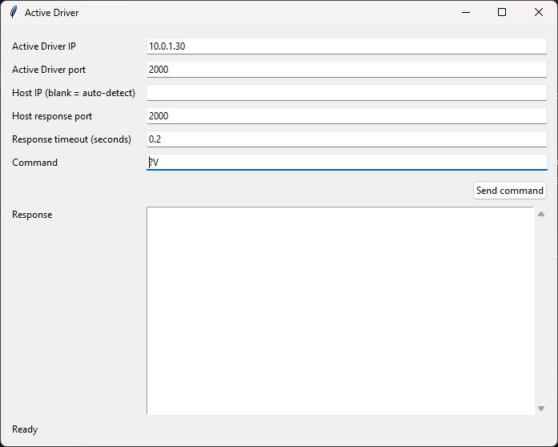
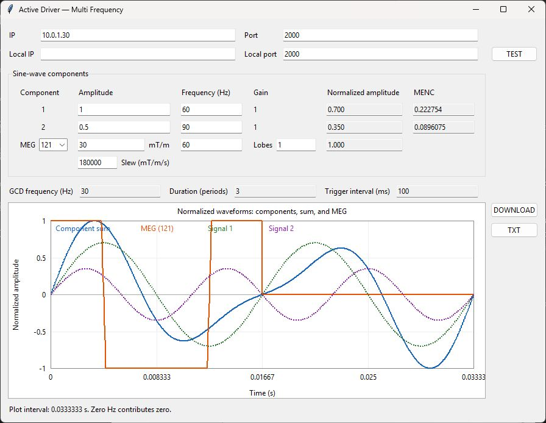

# Active Driver Python tools

Two Tkinter desktop applications provide a text-command interface and a
multi-frequency waveform preview. This directory also contains a command-line
client (`ad_cli.py`), the UDP transport (`udp.py`), and device commands (`api.py`).

## Setup on Windows

Use Python 3.10 or newer with Tkinter installed. The screenshots below were
captured on Windows using Python 3.14. `netifaces` is the external dependency
listed in `requirements.txt`.

Open PowerShell in the repository root and run:

```powershell
py -m venv .venv
.\.venv\Scripts\python.exe -m pip install -r .\python\requirements.txt
```

These commands use the virtual environment directly, so activation is not
required. Run the launch commands below from the repository root as well.

## Launch the command GUI

```powershell
.\.venv\Scripts\python.exe .\python\ad_gui.py
```



1. Set **Active Driver IP** and **Active Driver port** for your device.
2. Leave **Host IP** blank to select an adapter on the device's subnet, or enter
   the local adapter's IPv4 address.
3. Set **Host response port** to match the device's UDP output port.
4. Enter an ASCII command, such as `?V` to query the version, and click
   **Send command** or press Enter in the command field.

Replies appear under **Response**, and the bottom status line reports readiness
or errors. **Response timeout** defaults to `0.2` seconds and controls the wait
for response batches. Both port fields accept values from `1` to `65535`.

## Launch the multi-frequency GUI

```powershell
.\.venv\Scripts\python.exe .\python\ad_gui_mf.py
```



The plot updates as you edit the two sine-wave amplitudes and frequencies.
It shows the normalized component sum, the individual components, and the MEG
waveform. MEG settings include type (`121` or `11`), amplitude in mT/m,
frequency, lobe count, and slew rate in mT/m/s. Calculated fields show normalized
amplitudes, MENC values, GCD frequency, duration in periods, and trigger interval.

- **TXT** saves the normalized component sum as 1,024 samples, one value per
  line with seven decimal places. Previewing and exporting need no device.
- **TEST** queries the device version using **IP**, **Port**, and **Local port**.
  It automatically selects the local adapter; this button currently does not
  use the **Local IP** field.
- **DOWNLOAD** selects the device's custom waveform mode and writes the
  normalized component sum to its waveform memory. It uses **Local IP** if
  supplied, otherwise it automatically selects the adapter. The MEG preview
  is not included in the downloaded or exported samples.

Both screenshots show the actual applications at startup, without a device
connection or simulated device responses.

## Network settings and troubleshooting

The default device address is `10.0.1.30`; the device and local response ports
both default to `2000`. Configure your computer's network adapter on the
device's subnet and match the local response port to the device's UDP output
port. Allow incoming UDP replies through the firewall on that local port.

If no matching adapter is found, check your network configuration or supply
**Host IP** / **Local IP** where supported. If replies do not arrive, check the
device address, cabling, UDP output port, and firewall configuration.

If Python reports a missing `netifaces` module, install the requirements using
the same interpreter you use to launch the GUI. If pip needs to compile
`netifaces`, its build may require Microsoft C++ Build Tools. If `tkinter` is
missing, modify your Python installation to include Tcl/Tk support.

## Command-line alternative

From the repository root:

```powershell
.\.venv\Scripts\python.exe .\python\ad_cli.py --help
.\.venv\Scripts\python.exe .\python\ad_cli.py '?V'
.\.venv\Scripts\python.exe .\python\ad_cli.py '?V' --ad-ip 192.168.6.2 --host-ip 192.168.6.10 --timeout 0.5
```

Additional options are `--ad-port` and `--host-port` (both default to `2000`).
Quote commands that contain spaces. See the Active Driver communications manual
for the full command list.

[Project overview](../readme.md) | [C# client](../cs/readme.md)
